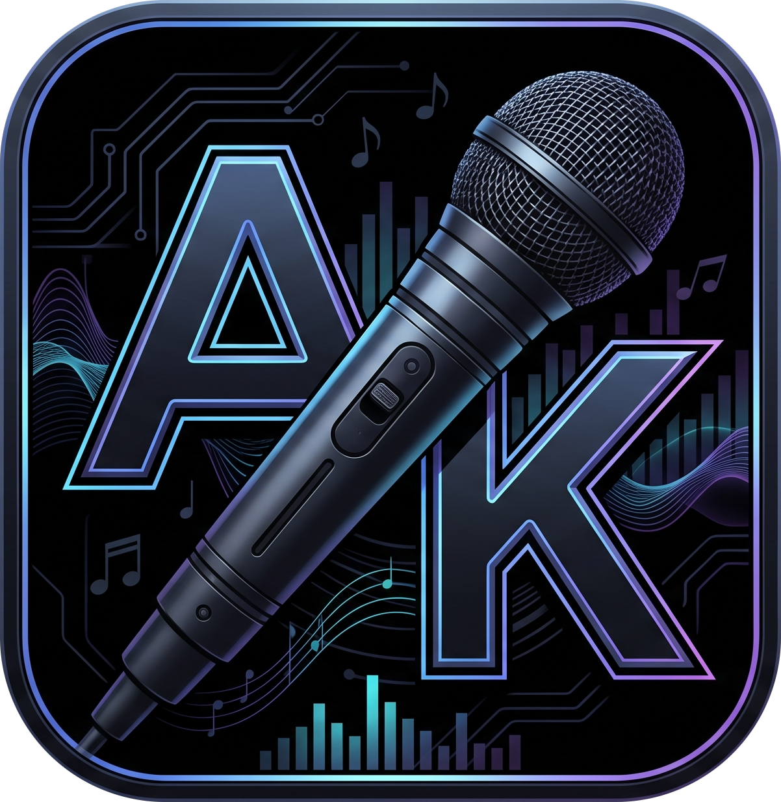
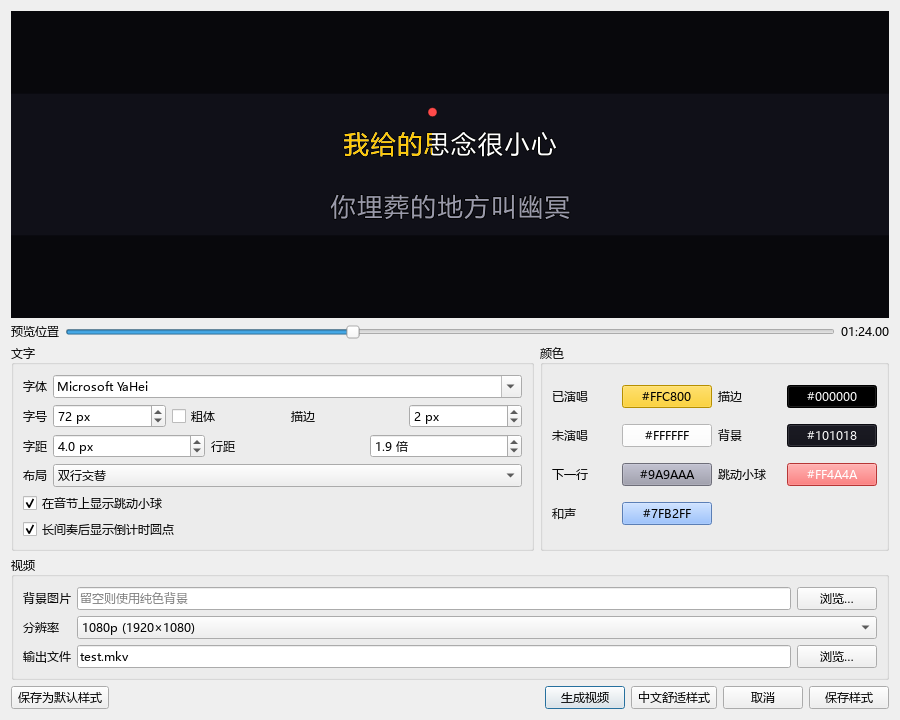
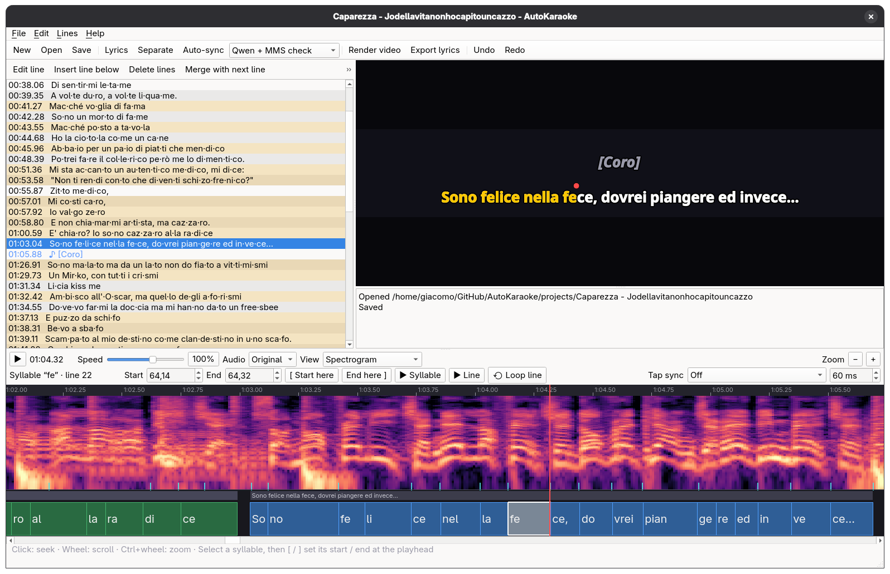
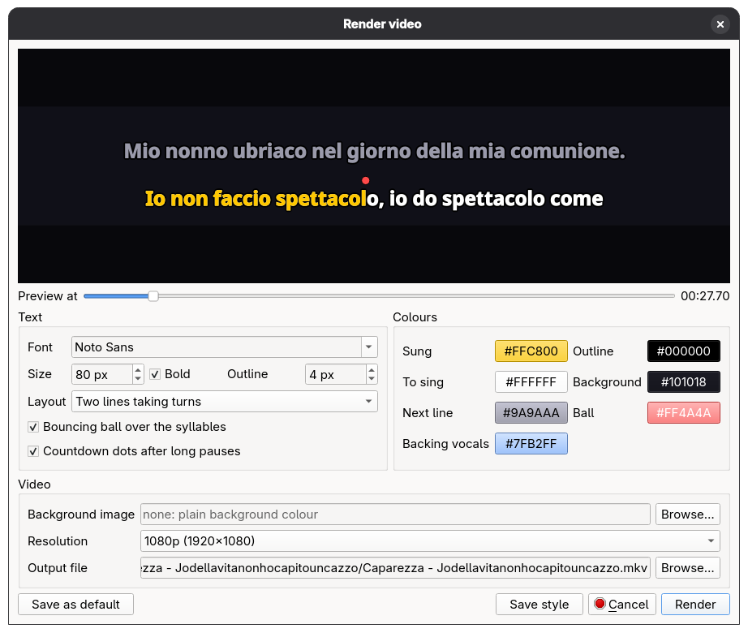

<p align="center">
  
</p>

<h1 align="center">AutoKaraoke</h1>

> **项目来源**：本仓库基于 [GiacoBot/AutoKaraoke](https://github.com/GiacoBot/AutoKaraoke)，
> 原项目由 [GiacoBot](https://github.com/GiacoBot) 及其贡献者开发。
> [Dhz8678/AutoKaraoke](https://github.com/Dhz8678/AutoKaraoke) 是在原项目基础上维护的中文增强衍生版本，
> 保留原项目历史与 [GPL-3.0-or-later 许可证](LICENSE)。
>
> This is a modified Chinese-language fork of [GiacoBot/AutoKaraoke](https://github.com/GiacoBot/AutoKaraoke).
> Credit for the original application belongs to GiacoBot and its contributors.

<p align="center">
  Turn a song you own into a karaoke video, synced syllable by syllable.<br>
  AI does the rough work, you do the fine-tuning.
</p>

<p align="center">
  
</p>

AutoKaraoke takes an audio file and:

1. finds the lyrics on [LRCLIB](https://lrclib.net) (or loads them from a file, or transcribes them
   from the vocals);
2. separates the vocals from the music;
3. syncs every syllable of the lyrics to the voice with speech AI models;
4. lets you check and fix the timing in an editor made for it;
5. renders a karaoke video with the instrumental, the original and the vocals as switchable
   audio tracks.

Audio separation, recognition and alignment run locally on your computer. Optional lyric
correction sends lyric text and a local transcript to the API service you configure.

## 中文增强版

本次增强基于上游提交 [`3b7098f`](https://github.com/GiacoBot/AutoKaraoke/commit/3b7098f8a4847bc7d55238c6860a5f8b22cf5dc7)。
原项目提供音频分离、歌词获取、音节对齐、时间轴编辑和视频生成；本分支在这些功能上进行以下修改。

此仓库包含中文界面、AI 组件和模型的实时下载进度、人声分离处理进度、任务取消、
简体歌词转换，以及可自定义地址、密钥、模型并测试连接的歌词修正 API。
生成视频窗口可调整字体、字号、字距和行距，并实时预览。

使用方法、下载源、本地模型和验证范围见 **[中文增强版说明](docs/中文增强版说明.md)**。
这些改动已包含在当前源码中；已有 Releases 的安装包不一定包含本次改动。



## Features

- **Syllable-level sync**: the highlight follows each syllable, not just each line. Two AI
  aligners check each other, and the syllables they disagree on are marked for review.
- **An editor made for fixing timing**: a timeline with waveform or spectrogram, draggable
  syllable blocks that snap to the vocal attacks, playback from 25 to 150 % speed, loops, and
  tap-along sync with the space bar.
- **Lyrics editing**: fix, split, merge, add or delete lines when the published lyrics do not
  match the recording.
- **Backing vocals**: mark a choir or a yodel as *backing*. It stays in the karaoke audio,
  fading in and out exactly on its syllables, and shows in the video in italics.
- **Video style**: font, size, colours (sung, to sing, next line, backing, background), two lines
  taking turns or current + next, a bouncing ball on each syllable, countdown dots after long
  pauses, a background image. The editor preview matches the video.
- **Multilingual**: syllable splitting for many languages, alignment in about 1100.

## Screenshots





## Download

| System | Package | |
|---|---|---|
| Linux (x86-64) | `AutoKaraoke-<version>-x86_64.AppImage` | [Releases](../../releases/latest) |
| Windows 10/11 (x64) | `AutoKaraoke-<version>-windows-x64.zip` | [Releases](../../releases/latest) |
| macOS | not packaged yet: [run it from source](#run-from-source) (untested) | |

### Requirements

- 64-bit Windows 10/11 or Linux, and an internet connection the first time.
- **RAM**: 8 GB minimum, 16 GB recommended (syncing on the CPU alone peaks at about 7 GB).
- **Disk**: 15-20 GB free for the AI components and models.
- **Graphics card**: an **NVIDIA GPU with 6 GB of video memory or more** makes the AI steps fast
  (they use about 4 GB). Without one, or with Intel / AMD graphics, everything runs on the
  CPU: it works, but it is slow.

How long a 4-minute song takes, model loading included:

| Step | NVIDIA RTX 4060 Ti | CPU only, desktop (Intel i7-13700K) |
|---|---|---|
| Separate vocals | ~25 s | ~4 minutes |
| Auto-sync syllables | ~10 s | ~1 minute |

Editing and rendering the video are fast on any PC. The first run of each step also downloads
its AI model.

The packages are small launchers (~140 MB, ffmpeg included). The first start downloads Python
and the editor (a few hundred MB). The first time you separate or sync a song, the app offers to
download the AI components: 3-4 GB with an NVIDIA card (PyTorch with CUDA), under 1 GB without
one (the CPU-only PyTorch, chosen automatically). Then each AI model downloads the
first time it is used.

- **Linux**: make the file executable (`chmod +x AutoKaraoke-*.AppImage`, or *Properties →
  Allow executing*) and open it. Everything is installed in `~/.local/share/autokaraoke`;
  projects go to `~/AutoKaraoke`.
- **Windows**: unzip the folder anywhere and double-click `AutoKaraoke.bat`. If Windows warns
  about an unknown app, choose *More info → Run anyway*. Everything is installed in
  `%LOCALAPPDATA%\AutoKaraoke`; projects go to `Documents\AutoKaraoke`.

The packages cannot download audio from YouTube or other streaming services: use audio files
you own.

## Making a karaoke

1. **New…**: pick an audio file (MP3, FLAC, WAV, M4A, OGG…). Artist and title are guessed from the
   file name (`Artist - Title.mp3`), and the lyrics are looked up on LRCLIB.
2. **Lyrics**, if nothing was found: load a `.lrc` / `.txt` file, or *Transcribe from vocals*.
3. **Separate**: splits vocals and instrumental.
4. **Auto-sync**: times every syllable. Blocks in yellow or red are the ones to check.
5. **Fix** what is off, in the timeline and the lyrics list (see below).
6. **Render video**: choose the style and render. The video has switchable audio tracks: the
   instrumental (by default), the original and the vocals only. If you marked backing vocals, a
   *Karaoke* track with them comes first.

Press **F1** in the app for all the shortcuts.

### Fixing the timing

- Click a syllable: **P** plays it, **L** loops its line. Drag the block or its edges: they snap
  to the cyan ticks of the vocal attacks; hold **Ctrl** to place them freely. You can also press
  **[** / **]** at the right moment, type the times, or nudge with **Ctrl+← / →**.
- **View → Spectrogram** makes consonants visible as bright vertical streaks, which is where
  syllables start.
- **Tap sync**: select the first syllable, choose *Hold* (press = start, release = end) or *Tap*
  (each tap starts a syllable), and tap the space bar along with the song. The *Speed* slider
  slows it down.
- Drag the edge above the timeline to make it taller, and the line above the syllables to make
  the blocks taller.

### Fixing the lyrics

Published lyrics often differ from the recording. In the lyrics list (right-click, or the *Lines*
menu), you can:

- edit a line with **Enter**; typing a new line splits it in two;
- insert a line with **Insert**, delete with **Delete**, merge with **Ctrl+J**;
- mark a line as **backing vocals** with **B**.

Syllables are split automatically. For a line like `(coro)`, uncheck *Split words into syllables
automatically* in the edit window, or put `|` where you want a split (`cuo|re`).

## How this project was born

The idea came from a friend more than a year ago: a tool to make karaoke videos of any song,
with the words lighting up syllable by syllable. Back then I could not get a working demo
together. Now, working with Claude, I could finally give my idea a shape. The
idea, the choices about how it should work and user experience design are mine; the code was
written with Claude Opus 5.5.

## Contributing

It is a small, finished program, not a perfect one. Bug reports, ideas and pull requests are
welcome: please [open an issue](../../issues). For problems with the packages, include what the
first-start window printed. On Linux, run the AppImage from a terminal to see the full output;
on Windows the app writes a log to `%APPDATA%\autokaraoke\autokaraoke.log`.

---

## For developers and command-line users

### Run from source

Requires [uv](https://docs.astral.sh/uv/) and `ffmpeg` with libass in `PATH`. Works on Linux and
Windows, and should work on macOS (untested, no GPU acceleration).

```sh
git clone <this repository> && cd AutoKaraoke
uv sync --extra all         # or pick: --extra gui --extra separation --extra align --extra gpu [--extra download]
uv run autokaraoke gui ["projects/Artist - Title"]
uv run pytest               # tests
```

Pick one PyTorch build: `--extra gpu` (CUDA, for NVIDIA cards) or `--extra cpu` (much smaller,
CPU only). `all` includes `gpu`.

### Command line

Every step of the pipeline is a subcommand; `run` chains them all.

```sh
uv run autokaraoke run "Artist - Title.mp3"          # whole pipeline, video in the project folder

uv run autokaraoke new song.flac --artist "Artist" --title "Title"
uv run autokaraoke lyrics "projects/Artist - Title" --lrc-file lyrics.lrc   # or --from-audio
uv run autokaraoke separate "projects/Artist - Title"
uv run autokaraoke align "projects/Artist - Title"    # --engine qwen|mms|naive
uv run autokaraoke render "projects/Artist - Title"   # --background image.jpg --layout scroll --no-ball
uv run autokaraoke export "projects/Artist - Title" --format lrc   # or ass
```

`uv run autokaraoke <command> --help` lists the options. A project is a folder with
`project.akp.json`, the audio stems and the outputs. The AppImage accepts the same commands:
`./AutoKaraoke-*.AppImage render "…"`.

Environment variables: `AUTOKARAOKE_PROJECTS` (projects folder, default `./projects`),
`AUTOKARAOKE_MODELS` (separation models, default `~/.cache/autokaraoke/models`),
`AUTOKARAOKE_SEPARATION_MODEL` (any [audio-separator](https://github.com/nomadkaraoke/python-audio-separator)
model, default `vocals_mel_band_roformer.ckpt`). The speech models are cached by Hugging Face in
`~/.cache/huggingface`.

### How the alignment works

1. Lyrics are split into syllables (Hunspell hyphenation via `pyphen`, one unit per character for
   CJK).
2. **[Qwen3-ForcedAligner-0.6B](https://github.com/QwenLM/Qwen3-ASR)** aligns each LRC line on the
   separated vocals, with its neighbouring lines as context. A timestamp slot follows every
   syllable.
3. The **MMS CTC aligner** (`mms-300m-1130-forced-aligner`, ~1100 languages through `uroman`)
   aligns the same lines independently. Where the two disagree, syllables are flagged; where Qwen
   loses track (layered backing vocals, "ba-dee-ya" refrains), the MMS result is used instead.
4. Lyrics without timestamps (plain text, or transcribed) are first located in a
   **[Qwen3-ASR-1.7B](https://github.com/QwenLM/Qwen3-ASR)** transcript of the vocals by fuzzy
   word matching.
5. Post-processing fixes known failure modes (first syllable glued to the previous line,
   zero-length syllables) using the vocal energy envelope, and assigns a confidence to every
   syllable.

The editor's attack ticks come from a spectral-flux onset detector on the vocal stem
(`spectrum.py`); the bouncing ball is placed with the same font metrics libass uses (`fonts.py`).

### Lyric check with an LLM (experimental, off by default)

The vocals are transcribed locally (Qwen3-ASR). A text-only LLM proposes changes to the
lyrics: expanded choruses, removed `[Chorus]` labels, wrong words. You accept or reject them
one by one. It only edits text, never timing. The results are hit and miss, so it is
disabled unless you enable it in *File → Settings…* (or set
`AUTOKARAOKE_EXPERIMENTAL_LLM=1`).

Settings accepts a custom Chat Completions base URL, API key and model, including compatible
self-hosted services. **Test connection** checks the current inputs without saving them or
sending lyrics/audio. A local service without authentication can leave the key empty.
The default service is [OpenRouter](https://openrouter.ai), using
`deepseek/deepseek-v4.1-flash`; charges depend on the selected provider and model.

Environment or `.env` configuration uses `AUTOKARAOKE_LLM_BASE_URL`,
`AUTOKARAOKE_LLM_API_KEY` and `AUTOKARAOKE_LLM_MODEL`. The legacy `OPENROUTER_API_KEY` is
used only for OpenRouter. These settings affect lyric text correction; the audio models
still run locally. See the [Chinese guide](docs/中文增强版说明.md) for model IDs and download sources.

### Audio download

Downloading from YouTube / YT Music (`yt-dlp`) works only when running from source with the
`download` extra. It is disabled in the release packages, for ethical reasons and because it
breaks often.

### Building the release packages

On Linux (or WSL), from the repository:

```sh
uv run python packaging/build.py            # both, or: linux / windows
```

It writes `dist/AutoKaraoke-<version>-x86_64.AppImage` and
`dist/AutoKaraoke-<version>-windows-x64.zip`, ready to attach to a GitHub release. The script
downloads (and caches in `packaging/.cache`) uv, a static GPL build of ffmpeg and appimagetool,
copies the source with audio download switched off, and adds the launchers from
`packaging/linux` and `packaging/windows`.

The packages contain no Python libraries. The launcher runs `uv sync` from the bundled `uv.lock`
into the user's data folder: the editor libraries first, then the AI extras on request from
inside the app (`components.py`). This keeps the downloads small and lets Windows get PyTorch
with CUDA from the PyTorch index (see `[tool.uv.sources]` in `pyproject.toml`). A new release
with a changed `uv.lock` updates the installed libraries on its first start.

The version comes from `pyproject.toml`.

## Licenses

AutoKaraoke is free software, released under the [GNU General Public License v3.0 or
later](LICENSE): you can use, study, share and modify it, and versions you distribute must stay
free under the same license. The packages include ffmpeg (GPL v3, as a separate program) and uv
(MIT / Apache-2.0); see
[packaging/THIRD-PARTY.txt](packaging/THIRD-PARTY.txt).

The AI models are downloaded on first use, under their own licenses:

| Model | Use | License |
|---|---|---|
| Qwen3-ForcedAligner-0.6B | alignment | Apache 2.0 |
| Qwen3-ASR-1.7B | transcription (unsynced lyrics, lyric check) | Apache 2.0 |
| MMS-300M forced aligner | alignment cross-check and fallback | CC-BY-NC 4.0 (non-commercial) |
| MelBand RoFormer (Kim) | vocal separation | see its model card |
