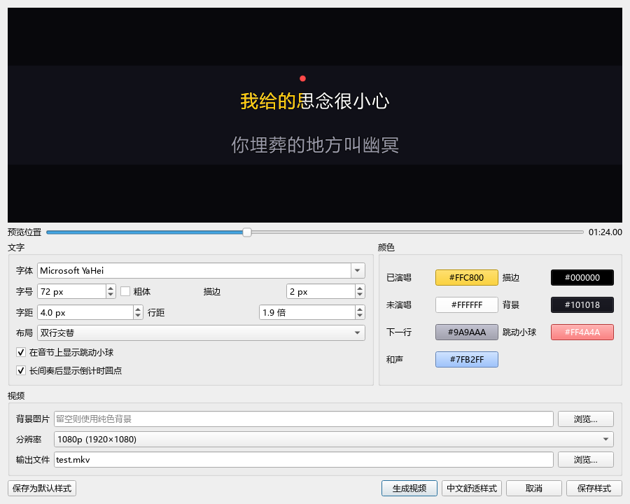

# AutoKaraoke 中文增强版

此分支源码包含中文界面、AI 组件与模型下载进度、人声分离处理进度、任务取消、简体歌词，以及歌词修正模型的自定义 API 地址和测试连接按钮。

## 启用更新

### 从本仓库源码运行

需要安装 uv，以及支持 libass 的 FFmpeg，并将 FFmpeg 加入 PATH。Windows NVIDIA 显卡示例：

```powershell
git clone https://github.com/Dhz8678/AutoKaraoke.git
cd AutoKaraoke
uv sync --extra gui --extra separation --extra align --extra gpu
uv run autokaraoke gui
```

使用 CPU 时，将 `--extra gpu` 换为 `--extra cpu`；不要同时选择两项。AI 依赖与模型较大，首次运行需要联网下载。现有 Releases 中的旧安装包不一定包含此分支的增强功能。

### 已安装并应用本机更新

保存项目并等待当前任务结束，关闭软件，再双击原来的 `AutoKaraoke.bat`。已应用本机补丁的启动器会进入 `app-zh` 中文程序目录，继续使用现有 Python 环境、依赖、模型缓存和项目；原 `app` 目录保留。`app-zh` 是本机更新目录，不是本仓库的源码目录。

中文界面覆盖菜单、按钮、设置、工具提示、快捷键帮助、生成视频、歌词修改建议和主要状态/错误提示。第三方安装器、模型库的原始诊断日志保留原文。

## 下载进度

AI 组件安装时，日志上方显示两种独立进度：

- 组件准备／安装进度：按完成的组件数量统计，并标明当前阶段。
- 当前最大下载项：显示名称、已下载量／总量、百分比及观测平均速度。例如 `torch` 的大文件会持续更新。

组件进度来自 uv 的实时输出。Qwen / MMS 等 Hugging Face 模型及人声分离模型的下载也会显示已下载量、总量、百分比和观测平均速度。人声分离处理中，显示分离器提供的实际分段／批次完成比例。

各阶段独立计数：模型下载的百分比与音频处理的百分比分别显示。等待服务器响应、加载模型等没有可用总量的阶段，显示当前阶段、耗时和等待提示，不推算虚假的百分比。运行环境被其他安装任务占用时，会显示等待原因；等待一分钟仍未释放则提示重试，不会自动停止其他进程。

任务运行时，为避免冲突操作，编辑和处理按钮暂时禁用。日志上方持续显示任务状态，并提供“取消任务”；取消请求需要等待当前网络操作或计算步骤响应，完成后恢复操作。已完成的模型缓存保留，未完成的分离模型文件可能需要重新下载。

## 自定义歌词修正 API

在“文件 → 设置”中启用实验性歌词修正，填写：

| 配置 | 说明 |
|---|---|
| API 基础地址 | 兼容 Chat Completions 的服务地址，例如 `http://127.0.0.1:8000/v1`；也支持完整的 `/chat/completions` URL |
| API 密钥 | 按服务商要求填写；本地无鉴权服务可以留空 |
| 歌词修正模型 | 填写该服务实际提供的模型名称／ID |

服务须支持 `/chat/completions`，并能根据提示返回歌词修正需要的 JSON 对象。自建本地模型、国内服务或其他兼容服务均可配置；专有协议需要另外适配。仅输入服务根地址时默认补充 `/v1/chat/completions`。

“测试连接”使用当前输入框中的地址、密钥和模型，无需先保存。它只发送一条短测试文本，检查接口和模型能否返回 JSON，显示成功／失败原因及耗时；不会上传歌曲或歌词，也不会自动保存当前输入。测试请求的超时设置为 30 秒，且不自动重试。

默认仍为 `https://openrouter.ai/api/v1`，兼容已有 OpenRouter 设置。自定义服务不会收到 OpenRouter 专有的 `usage`、`reasoning` 参数；本地免密接口也不会自动收到旧的 OpenRouter 专用密钥。

配置保存在 `%APPDATA%\autokaraoke\.env`：`AUTOKARAOKE_LLM_BASE_URL`、`AUTOKARAOKE_LLM_API_KEY`、`AUTOKARAOKE_LLM_MODEL`。仅配置地址不会自动启用实验性功能。

歌词修正只发送歌词与本地识别得到的文本；远程 URL 会将这些文本发送给对应服务，本地 URL 则发送给你部署的本机服务。它与下面的音频 AI 模型相互独立。

## 首次启动下载什么、来自哪里

| 阶段 | 下载内容 | 默认来源 |
|---|---|---|
| 首次启动 | Python 和编辑器依赖（如 PySide6） | Python 来自 [Astral python-build-standalone](https://github.com/astral-sh/python-build-standalone/releases)；依赖使用 [PyPI](https://pypi.org/simple)，文件来自 `files.pythonhosted.org` |
| 首次启用 AI | PyTorch、torchvision、audio-separator、qwen-asr、transformers、ONNX Runtime 等运行组件 | 普通组件使用 PyPI；Windows NVIDIA 版 PyTorch 使用 [CUDA 13.0 索引](https://download.pytorch.org/whl/cu130)，CPU 版使用 [CPU 索引](https://download.pytorch.org/whl/cpu) |
| 首次使用具体功能 | 人声分离、识别与对齐模型权重及配套配置／词表 | 见下表，按需下载 |

原软件提示：NVIDIA 版运行组件约 3～4 GB，CPU 版小于 1 GB；模型权重另占空间。提示中的约 5 GB 是原软件的粗略估算，具体总量取决于实际使用的模型和缓存情况。

| 模型 | 用途 | 默认下载源 |
|---|---|---|
| `vocals_mel_band_roformer.ckpt`（MelBand RoFormer） | 人声／伴奏分离 | 由 [audio-separator 下载器](https://github.com/nomadkaraoke/python-audio-separator/blob/v0.47.0/audio_separator/separator/separator.py) 从 UVR / audio-separator 的 GitHub 模型资源仓库获取，另含 YAML 配置及模型索引 |
| `Qwen/Qwen3-ForcedAligner-0.6B` | 歌词音节时间对齐 | [Hugging Face 模型仓库](https://huggingface.co/Qwen/Qwen3-ForcedAligner-0.6B) |
| `MahmoudAshraf/mms-300m-1130-forced-aligner` | 对齐交叉校验／多语言后备 | [Hugging Face 模型仓库](https://huggingface.co/MahmoudAshraf/mms-300m-1130-forced-aligner) |
| `Qwen/Qwen3-ASR-1.7B` | 从音频识别歌词，无时间信息歌词的定位 | [Hugging Face 模型仓库](https://huggingface.co/Qwen/Qwen3-ASR-1.7B)；识别时也会使用上述 Qwen 对齐模型 |

这些音频模型下载后在本机执行推理，不需要 OpenRouter。歌词检索来自 `https://lrclib.net/api`，它是在线歌词数据查询。

默认缓存路径：

- Python 和运行依赖：`%LOCALAPPDATA%\AutoKaraoke`。
- 人声分离模型：`%USERPROFILE%\.cache\autokaraoke\models`。
- Qwen、MMS 模型：`%USERPROFILE%\.cache\huggingface\hub`。

原版可通过 `AUTOKARAOKE_SEPARATION_MODEL` 切换分离模型，通过 `AUTOKARAOKE_MODELS` 更换分离模型缓存目录；其他音频模型 ID 尚未增加图形化自定义入口。以上是默认配置，环境变量或 uv/Hugging Face 配置可以改变实际位置和来源。

## 中文歌词

中文排版默认使用中文无衬线字体、72 px 字号、4 px 字距、1.9 倍行距及较轻描边。Windows 下使用实际中文字体文件测量字宽，避免使用西文字宽估算导致汉字重叠。

在“生成视频”窗口可调整字体、字号、字距和行距，或点击“中文舒适样式”一键应用。点击“保存样式”后返回主界面，按 Ctrl+S 将设置写入项目文件；“保存为默认样式”用于新项目和未指定样式的项目。已有明确保存的字体设置会保留，可用“中文舒适样式”切换为新的中文样式。预览、跳动小球位置和导出字幕使用相同字距参数。下方编辑时间轴的缩放独立于视频字体，可用“缩放 +”或 Ctrl+滚轮放大。



“和声”颜色用于被标记为和声的歌词。主界面的“设为和声／取消和声”切换选中行的和声标记；生成卡拉 OK 音轨时会保留这些行时间范围内的原有人声，并不是生成或单独提取和声。取消标记不会删除歌词。生成视频窗口的“取消”则放弃本次尚未保存的调整并关闭窗口。

歌词来源可能提供繁体文本，原版直接保留来源字形。新版默认将中文歌词转为简体，并优先检查汉字、假名、韩文等文字特征，避免将纯中文歌词识别为韩语 `ko`。

“文件 → 设置”可关闭“中文歌词自动转为简体”以保留来源原文。已有项目可使用“歌词行 → 转为简体中文”；默认设置下重新打开中文项目也会规范字形和语言标记。转换保留行时间、音节时间、置信度及和声标记，转换前另存项目 JSON 备份，可撤销字形修改。转换在内存中进行，保存项目后才写入原项目文件。

Windows 版使用系统简繁转换功能，不需要为此下载模型。其他平台如需字形转换可安装 OpenCC；文字语言识别不依赖 OpenCC。若原转写缓存记录了错误语言，后续转写时会重新识别，不复用不匹配的语言缓存。

## 验证范围

2026-11-13 在 Windows 上重新运行完整测试：83 项通过，另有 10 项子测试通过。测试涵盖自定义 API、进度解析与任务状态、中文转换和字体间距；这不是新安装包的发布记录。

已验证全套本地测试、自定义 API 请求及设置保存、未保存配置的连接测试、中文原生按钮、简体转换和时间信息保留、失败／取消／等待状态，以及实际捆绑 uv 的连续字节进度。

另通过本机限速 HTTP 服务调用实际 audio-separator 下载器，并通过 Qt 后台任务传递到界面，验证模型下载的连续百分比、处理步骤计数和结束后按钮恢复；`pythonw.exe` 启动的 uv 下载也已验证。测试不连接你的模型供应商，不消耗你的 API 额度；尚未使用你的歌曲和自建接口完成实际歌词修正或完整模型推理验收。
